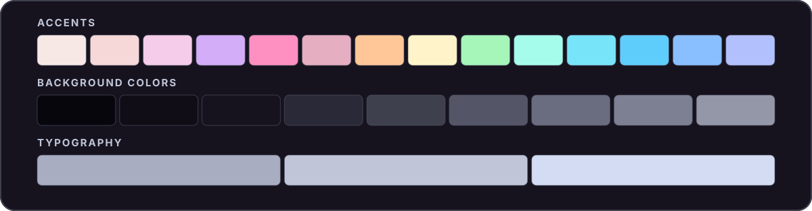

<div align="center">

# ☕ Moretta

**moh-RET-tah**

An unofficial, ultra-dark [Catppuccin](https://catppuccin.com/)-inspired color palette.



</div>

## Palette

### Accents

| Color | Hex | Color | Hex |
| :-- | :-- | :-- | :-- |
| Rosewater | `#f7e8e6` | Yellow | `#fff4c9` |
| Flamingo | `#f6d8d8` | Green | `#a6f5b9` |
| Pink | `#f5cce9` | Teal | `#a6fceb` |
| Mauve | `#d3adf7` | Sky | `#78e4f9` |
| Red | `#fe90c1` | Sapphire | `#5fcdfc` |
| Maroon | `#e6aec1` | Blue | `#89bfff` |
| Peach | `#ffc697` | Lavender | `#b3c0fe` |

### Background Colors

| Color | Hex | Color | Hex |
| :-- | :-- | :-- | :-- |
| Crust | `#06060c` | Mantle | `#100d16` |
| Base | `#16131f` | Surface 0 | `#292937` |
| Surface 1 | `#3f404d` | Surface 2 | `#545667` |
| Overlay 0 | `#6a6c7f` | Overlay 1 | `#7d8092` |
| Overlay 2 | `#9397a8` | | |

### Typography

| Color | Hex |
| :-- | :-- |
| Text | `#d3dcf2` |
| Subtext 1 | `#c0c6d8` |
| Subtext 0 | `#a8adc2` |

## Files

| File | Format |
| :-- | :-- |
| [`moretta.json`](moretta.json) | Named hex colors |
| [`moretta.css`](moretta.css) | CSS custom properties (`--ctp-moretta-*`) |
| [`whiskers-overrides.json`](whiskers-overrides.json) | Optional Whiskers color overrides |

### CSS

Load [`moretta.css`](moretta.css) and reference the variables:

```css
@import url("./moretta.css");

body {
  background: var(--ctp-moretta-base);
  color: var(--ctp-moretta-text);
}

a {
  color: var(--ctp-moretta-blue);
}
```

<details>
<summary>Whiskers</summary>

Render a [Whiskers](https://whiskers.catppuccin.com/concepts/overrides/) template with Moretta colors and flavor names:

```sh
sed -E \
  -e 's/\{\{[[:space:]]*flavor\.identifier[[:space:]]*\}\}/moretta/g' \
  -e 's/\{\{[[:space:]]*flavor\.name[[:space:]]*\}\}/Moretta/g' \
  template.tera | whiskers - -f mocha --color-overrides whiskers-overrides.json
```

</details>

## License

[MIT](LICENSE). Moretta is an independent project, not affiliated with or endorsed by Catppuccin.
